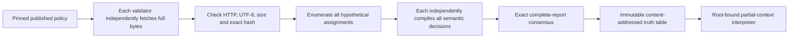
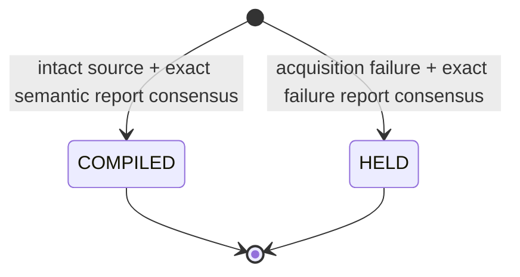

# BoundedPolicyCompiler

An experimental GenLayer compiler from a published policy to an immutable, four-valued truth table. Compile once through independent validator reasoning; simulate many hypothetical contexts with deterministic reads.

**Not an authorization system.** Query conditions are hypothetical inputs, not verified observations. The contract never claims a caller is staff, supervised, compliant or physically safe. It stores no funds and executes no real-world action.

## Problem and why GenLayer

A normal smart contract can execute a decision table but cannot reliably derive it from natural-language rules containing exceptions, priorities, silence and contradictions. A private AI compiler could silently misinterpret a rule. GenLayer validators independently acquire the complete published source and recompile every consequential cell before a reusable function is installed onchain.

The caller supplies only the action vocabulary, 1–4 Boolean predicate definitions, source coordinates and SHA-256 commitment. It cannot submit the document body, table, permission result, confidence or policy summary. The authoritative content is fetched inside each nondeterministic execution.



## Distinct mechanism, not a renamed submission

| Existing mechanism | This project's different state and computation |
| --- | --- |
| Owner-controlled graph proposals and versioned heads | No owner, graph, edges, parent versions or mutable head; complete function compilation |
| `agent-intent-compiler` execution-plan gate | No goals/planners/DAG validation/activation gate; 2^N hypothetical decisions evaluated together |
| `normative-clause-index` paragraph category postings | No paragraph tags, inverted index or search; executable finite policy function and universal partial-context queries |
| Evidence certificate and one-time consumer | No certificate, principal permission, consumption, reset or replayable authorization |
| Sealed probability score accounting | No participants, commitments, reveal phases, scores or leaderboards |

Network acquisition and safe signing helpers are shared infrastructure patterns. The business mechanism is the truth-table compiler plus partial-information interpreter, not a domain rewrite of those helpers.

## Storage and workflow

`compile_policy(nonce, action, predicates, owner, repo, commit, path, expected_hash)` is permissionless. It creates an immutable creator/nonce attempt. The artifact's content address binds contract, policy semantics version, complete source coordinates/hash, action, and ordered predicate definitions.

Predicates are a bounded string: `staff=The operator is a staff member|supervised=A qualified supervisor is present|revoked=The operator's workshop access is revoked`. Identifiers and meanings must be unique. Input order determines bit positions: first predicate is bit 0. All 2^N assignments, at most 16, are generated by the contract—not supplied by a caller.

Each cell is one of:

- `ALLOW`: source unambiguously permits the hypothetical action in that context.
- `DENY`: source unambiguously forbids it.
- `CONFLICT`: applicable permission and prohibition contradict without an explicit priority/exception.
- `UNKNOWN`: ambiguity, silence, insufficient facts or inconsistent predicate meanings.

The model must consider the full document, including explicit overrides. Silence is not permission. Independent validators fetch and compile again, comparing the full canonical report: attempt binding, configuration, complete body, actual hash/status and every cell. No tolerance exists. Malformed model output fails execution; validators refuse LLM errors. Consensus disagreement does not install a function.



A `COMPILED` artifact may contain uncertain cells; those cells remain explicitly unusable for decisive queries. `HELD` attempts create **no artifact** and do not reserve its content address: another attempt can retry after publisher/network recovery. Successful artifacts are never overwritten. A duplicate compilation is rejected globally; a used attempt nonce is rejected within its authenticated creator namespace. Each creator has at most 32 attempts per deployment.

## Universal partial-context evaluation

`simulate(artifact_id, expected_root, known_mask, value_mask)` enumerates every full assignment consistent with known bits. Unknown bits must be zero in `value_mask`; bits outside the predicate domain and boolean-as-integer inputs are rejected.

- All completions `ALLOW` → `ALLOW`.
- All completions `DENY` → `DENY`.
- Anything else → `UNRESOLVED`, with explicit `has_unknown` and `has_conflict` flags.

The output exposes completion indexes and labels plus `hypothetical_only: true`. It is a conditional document interpretation, **not a fact check or execution permission**. No new LLM call occurs on reads. Consumers bind the exact artifact root and must independently establish actual facts before using a hypothetical result outside this contract.

## Example

The fictional workshop fixture states that revocation overrides permission; otherwise staff may use the cutter, while non-staff require supervision. For `[staff, supervised, revoked]`, indexes 0–7 compile to:

`[DENY, ALLOW, ALLOW, ALLOW, DENY, DENY, DENY, DENY]`.

| Known mask / values | Hypothesis | Expected interpretation |
| --- | --- | --- |
| `5 / 1` | Staff, not revoked; supervision unknown | ALLOW across both completions |
| `4 / 4` | Revoked; staff/supervision unknown | DENY across four completions |
| `4 / 0` | Not revoked; everything else unknown | UNRESOLVED; permissive and prohibited completions coexist |
| `0 / 0` | Nothing known | UNRESOLVED |

The unresolved fixture states only a revocation prohibition. Its nonrevoked cells must remain UNKNOWN; no caller or compiler may infer permission from silence. Authored fixtures demonstrate semantic compilation mechanics, not actual workplace rules, independent-source authority, legal compliance or machinery safety.

## Evidence integrity and limitations

Only contract-constructed `https://raw.githubusercontent.com/OWNER/REPO/FULL_COMMIT/PATH` sources are accepted, with safe relative `.txt`/`.md` paths. Full responses must be 1–8192 bytes and UTF-8. Hash before any interpretation; never classify a truncated body. Source rows and model output are defensively revalidated after consensus. Source pinning fixes a revision, not its current applicability or factual truth. The runtime is pinned on line one.

Models can share semantic errors or be susceptible to document prompt injection despite explicit data/instruction separation. Exact consensus proves agreement, not infallibility. Immutable uncertain/incorrect artifacts cannot be silently revised: corrected document bytes, changed predicate semantics, or a new deployment require explicit consumer selection. Restrict use to bounded non-critical simulations until independently audited.

## Install and test

```powershell
python -m venv .venv
.venv\Scripts\pip install -r requirements-dev.txt
npm ci --ignore-scripts
.venv\Scripts\genvm-lint check contracts/BoundedPolicyCompiler.py
.venv\Scripts\python -m pytest tests -q
npm run test:sdk
```

43 tests cover complete evidence acquisition, semantic changes altering compiled functions, all 256 two-predicate four-valued tables across 9 partial contexts (2,304 checks), four-predicate bit order, unknown/conflict propagation, bad source hashes/HTTP/encoding/size, retry after HELD, nonce replay, global deduplication, malformed/incomplete output, forged post-consensus reports, unsafe predicates/paths, and the actual independent validator callback. Direct-mode mocks/callback unit tests are not distributed consensus evidence. The narrow Windows fixture only defers gltest's open-tempfile unlink.

## Deploy and verify

```powershell
npm install -g genlayer@0.39.2
genlayer network set studionet
genlayer account create --name policy-test
genlayer account use policy-test
genlayer account unlock
genlayer deploy --contract contracts/BoundedPolicyCompiler.py
genlayer schema CONTRACT_ADDRESS
```

StudioNet is the gasless test environment; no funding is required. Native encrypted keystore/OS-vault signing avoids private-key export. Never paste passwords or keys into chat, source or command arguments. No value transfer is part of the demo.

For this repository's dedicated test signer, set `POLICY_TEST_ACCOUNT` and optionally `POLICY_CLI_PATH`, then use `node scripts/demo.mjs MODE ADDRESS FIXTURE_COMMIT`. Modes are `complete`, `unresolved`, `badhash`, `replay` (expected ERROR), and `duplicate` (expected ERROR). Arguments are passed directly to the CLI, avoiding PowerShell JSON quoting. `run-cli.cjs` hides raw receipts, deduplicates identical signed broadcasts and prints only public hashes. A timeout is uncertain: inspect history/known receipt before resending.

Read-only checks:

```powershell
node --dns-result-order=ipv4first scripts/check.mjs success TX_HASH
node --dns-result-order=ipv4first scripts/check.mjs error TX_HASH "Attempt nonce used"
node --dns-result-order=ipv4first scripts/check.mjs source CONTRACT_ADDRESS
node --dns-result-order=ipv4first scripts/check.mjs attempt CONTRACT_ADDRESS ATTEMPT_ID
```

Check both FINALIZED and execution SUCCESS; finalized ERROR receipts are negative tests, not successful compilations. Source verification fetches deployed code and compares normalized SHA-256. Attempt verification recomputes roots, body hash, compiled function and full/partial query results. Explorer paths are `/address/ADDRESS` and `/tx/HASH` at `https://explorer-studio.genlayer.com`. See [LIVE_PROOFS.md](LIVE_PROOFS.md) and [SUBMISSION.md](SUBMISSION.md) for actual finalized evidence when published.
